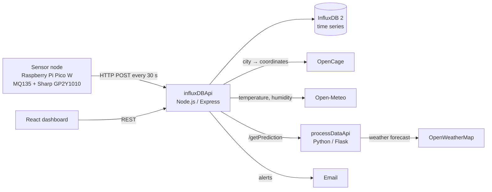

# AirQuality

[](https://github.com/Daneto123/AirQuality/actions/workflows/ci.yml)

An end-to-end IoT system that measures air quality, stores it as time series and forecasts
PM2.5 and PM10 levels with machine learning. Built as my Master's thesis at the Faculty of
Mathematics and Informatics, Sofia University (2025).

## How it works



1. **Sensor node** – MicroPython firmware reads an MQ135 gas sensor (CO2, NH3, benzene, using
   calibration curves) and a Sharp GP2Y1010AU0F dust sensor over ADC, then posts the readings
   with the device ID and city to the API.
2. **influxDBApi** – Express REST API that enriches each reading with coordinates and current
   weather, writes it to InfluxDB and serves it to the dashboard. It also calculates AQI
   categories, exports monthly PDF reports, backs data up to CSV and emails subscribers when
   dust levels stay high. API docs are served with Swagger at `/api-docs`.
3. **processDataApi** – Flask service that trains and runs the PM2.5/PM10 forecasting models.
   Linear regression, random forest and a neural network were compared (scikit-learn,
   TensorFlow), using historical [Sensor.Community](https://sensor.community/) data and weather
   forecasts as features.
4. **Frontend** – React dashboard with a live map (OpenLayers), forecast charts (Chart.js),
   a 7-day view and health recommendations.

## Tech stack

| Area | Technologies |
| --- | --- |
| Embedded | MicroPython, Raspberry Pi Pico W, MQ135, Sharp GP2Y1010AU0F |
| Backend | Node.js, Express, InfluxDB 2, Swagger, Nodemailer, PDFKit |
| Machine learning | Python, Flask, pandas, scikit-learn, TensorFlow |
| Frontend | React, React Router, OpenLayers, Chart.js |
| DevOps | Docker, Docker Compose, GitHub Actions |

## Run it

You need Docker with Docker Compose.

```bash
git clone https://github.com/Daneto123/AirQuality.git
cd AirQuality
cp .env.example .env    # then fill in your passwords and API keys
docker compose up --build
```

| Service | URL |
| --- | --- |
| Dashboard | http://localhost:3000 |
| API + Swagger docs | http://localhost:3060/api-docs |
| Forecasting service | http://localhost:5000 |
| InfluxDB UI | http://localhost:8086 |

You need free API keys from [OpenWeatherMap](https://openweathermap.org/api) and
[OpenCage](https://opencagedata.com/api). Email alerts need SMTP credentials.

### Sensor node

1. Flash MicroPython to the board.
2. Copy `backend/raspberryPiScript/wifi_config.example.py` to `wifi_config.py` and set your
   Wi-Fi name, password and the IP of the machine running the API.
3. Upload `raspSource.py` and `wifi_config.py` to the board.

### Training data

The repository includes a sample dataset from October–December 2024. See
[backend/influxDB/Data](backend/influxDB/Data/README.md) for its source and how to rebuild the
full dataset.

## Project structure

```
backend/
  raspberryPiScript/   MicroPython firmware for the sensor node
  influxDBApi/         Node.js REST API
  processDataApi/      Python forecasting service and models
  influxDB/Data/       Training data and processing scripts
frontend/              React dashboard
docs/                  Postman collection for the API
```
